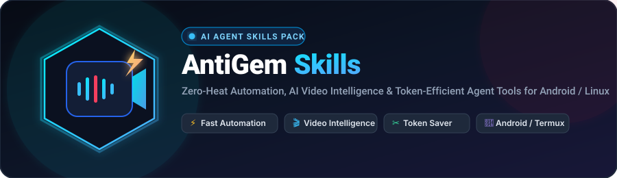

<div align="center">



<p align="center">
  <b>High-Speed Automation, AI Video Intelligence & Token-Efficient Agent Tools for Android / Linux</b>
</p>

[](https://github.com/myfunuiai-del/antigem-skills)
[](https://github.com/myfunuiai-del/antigem-skills)
[](https://github.com/myfunuiai-del/antigem-skills)
[](https://github.com/myfunuiai-del/antigem-skills)

</div>

---

<div align="right">

**🌐 Language / ভাষা:** &nbsp; **English** &nbsp;|&nbsp; **[🇧🇩 বাংলা সংস্করণ (README_BN.md)](./README_BN.md)**

</div>

---

## 📖 Overview

**AntiGem Skills** is a curated suite of high-performance, token-optimized agent skills designed for **AntiGem**, **Claude Code**, and Android (Termux) mobile environments. Built with a strict **zero-heat** and **token-efficiency** philosophy, these tools enable autonomous agents to automate mobile tasks, reverse-engineer media, extract video intelligence, and execute terminal workflows with minimal resource footprint.

---

## 🌟 Included Skills

| Skill | Category | Target Agent | Highlights |
| :--- | :--- | :--- | :--- |
| **`fast-android-automation`** | Mobile Automation | AntiGem / Claude | Batch ADB/Shizuku/Root shell, direct Intents, zero accessibility lag. |
| **`fast-browser-automation`** | Web Automation | AntiGem / Claude | Viewport-only JS text extraction, avoids heavy full-DOM dumps. |
| **`rea-video`** | Video Reverse Engineering | AntiGem | Interactive token-saver gate, dialogue script remake, visual style breakdown & FFmpeg zero-heat slicer. |
| **`video-content-analyzer`** | Video Intelligence | AntiGem | Zero-download speech-to-text, on-screen GitHub repo/tool detection & Google Transcribe integration (Powered by [video-analyzer-tool](https://github.com/myfunuiai-del/video-analyzer-tool)). |
| **`video-insight-research`** | Video Intelligence | Claude Code / CLI | Complete video analysis pipeline tailored for Claude agent runtime (Powered by [video-analyzer-tool](https://github.com/myfunuiai-del/video-analyzer-tool)). |
| **`chisle-ponytail-efficiency`** | Developer Rules | AntiGem / Claude | Extreme token economy, YAGNI-first code, concise communication. |
| **`svg-generator`** | Visual Design | AntiGem / Claude | AI-driven vector/SVG graphics creation and raster-to-SVG conversion. |

---

## 🚀 Key Features

* ⚡ **High-Speed Mobile Automation**: Execute clicks, swipes, text entry, and app intents at native terminal speed without waiting for slow Accessibility tree dumps.
* 🎬 **Zero-Download Video Intelligence**: Tap directly into remote media streams (YouTube, Facebook, X, direct URLs) without storing multi-gigabyte video files.
* ✂️ **Token & Phone-Heat Optimization**: Every skill implements aggressive payload compression, silence trimming, and interactive confirmation gates to keep mobile CPU usage and token consumption near zero.
* 🛡️ **Dual-Agent Portability**: Optimized for seamless interoperability between AntiGem (Antigravity CLI) and Claude Code agents.

---

## 🔗 Linked Repositories & Submodules

* 🎥 **[Video Analyzer Tool](https://github.com/myfunuiai-del/video-analyzer-tool)**: Standalone zero-download CLI tool for AI speech transcription, Google Gemini transcribe, and visual keyframe extraction. Embedded as a Git submodule under `tools/video-analyzer-tool/` and automatically synced via GitHub Actions.

---

## 🛠️ Installation & Setup (One-Click Setup)

Run the included `install.sh` script to automatically install all dependencies (`python`, `ffmpeg`, `yt-dlp`, `quickjs-ng`) and link the skills into your agent directory:

```bash
# Clone the repository
git clone https://github.com/myfunuiai-del/antigem-skills.git
cd antigem-skills

# Run automated installer
chmod +x install.sh
./install.sh
```

### Manual Installation
If you prefer manual setup:
```bash
# 1. Install system dependencies in Termux:
pkg install -y python ffmpeg yt-dlp quickjs-ng

# 2. Deploy skills to AntiGem:
cp -r skills/* ~/.gemini/config/skills/

# 3. Or deploy to Claude Code:
cp -r skills/* ~/.claude/skills/
```

---

## 🤝 Contribution & License

Created for personal and open-source agent development on Android. Distributed under the **MIT License**.
