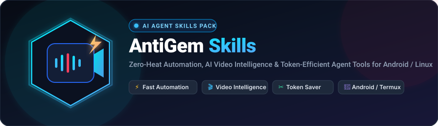

<div align="center">



<p align="center">
  <b>অ্যান্ড্রয়েড ও লিনাক্সের জন্য হাই-স্পিড অটোমেশন, এআই ভিডিও ইন্টেলিজেন্স ও টোকেন-সাশ্রয়ী এজেন্ট স্কিল প্যাক</b>
</p>

[](https://github.com/myfunuiai-del/antigem-skills)
[](https://github.com/myfunuiai-del/antigem-skills)
[](https://github.com/myfunuiai-del/antigem-skills)
[](https://github.com/myfunuiai-del/antigem-skills)

</div>

---

<div align="right">

**🌐 Language / ভাষা:** &nbsp; **[English (README.md)](./README.md)** &nbsp;|&nbsp; **🇧🇩 বাংলা সংস্করণ**

</div>

---

## 📖 পরিচিতি (Overview)

**AntiGem Skills** হলো **AntiGem**, **Claude Code**, এবং অ্যান্ড্রয়েড টারমাক্স (Termux) পরিবেশের জন্য বিশেষভাবে তৈরি উচ্চমানের ও টোকেন-অপ্টিমাইজড এজেন্ট স্কিল স্যুট। 

মোবাইল ডিভাইসে যাতে **কোনো অতিরিক্ত হিট (Phone Heat)** না হয় এবং **সর্বনিম্ন টোকেন খরচ** হয়—সেই দর্শন বজায় রেখে এই স্কিলগুলো তৈরি করা হয়েছে। এটি দিয়ে কৃত্রিম বুদ্ধিমত্তা সম্পন্ন এজেন্টরা স্বয়ংক্রিয়ভাবে মোবাইল ড্রাইভ, ভিডিও রিভার্স-ইঞ্জিনিয়ারিং, কোডিং ও মিডিয়া ইন্টেলিজেন্স হ্যান্ডেল করতে পারে।

---

## 🌟 অন্তর্ভুক্ত স্কিলসমূহ (Included Skills)

| স্কিল | ক্যাটাগরি | প্রযোজ্য এজেন্ট | প্রধান বৈশিষ্ট্যসমূহ |
| :--- | :--- | :--- | :--- |
| **`fast-android-automation`** | মোবাইল অটোমেশন | AntiGem / Claude | ব্যাচ ADB/Shizuku/Root শেল, ডিরেক্ট ইন্টেন্ট ও ল্যাগ-হীন দ্রুতগতির টাচ/সোয়াইপ। |
| **`fast-browser-automation`** | ওয়েব অটোমেশন | AntiGem / Claude | পুরো DOM ডাম্প বাদ দিয়ে শুধু দৃশ্যমান ভিউপোর্টের টেক্সট এক্সট্রাক্ট করে কম টোকেনে ব্রাউজিং। |
| **`rea-video`** | ভিডিও রিভার্স ইঞ্জিনিয়ারিং | AntiGem | কনফার্মেশন প্রশ্ন গেট, ডায়ালগ রিম্যাক স্ক্রিপ্ট, ভিজ্যুয়াল স্টাইল গাইড ও জিরো-হিট স্লাইসার। |
| **`video-content-analyzer`** | ভিডিও ইন্টেলিজেন্স | AntiGem | ফুল ডাউনলোড ছাড়াই স্পিচ-টু-টেক্সট, স্ক্রিনে দেখানো গিটহাব রেপো খোঁজা ও ক্লাউড ট্রানস্ক্রাইব ([video-analyzer-tool](https://github.com/myfunuiai-del/video-analyzer-tool) ভিত্তিক)। |
| **`video-insight-research`** | ভিডিও ইন্টেলিজেন্স | Claude Code / CLI | ক্লদ এজেন্টের জন্য অপ্টিমাইজড পূর্ণাঙ্গ ভিডিও অ্যানালাইসিস পাইপলাইন ([video-analyzer-tool](https://github.com/myfunuiai-del/video-analyzer-tool) ভিত্তিক)। |
| **`chisle-ponytail-efficiency`** | ডেভেলপার ফিলোসফি | AntiGem / Claude | এক্সট্রিম টোকেন এফিশিয়েন্সি, YAGNI-ফার্স্ট কোডিং এবং টু-দ্য-পয়েন্ট কমিউনিকেশন। |
| **`svg-generator`** | ভিজ্যুয়াল ডিজাইন | AntiGem / Claude | Quiver AI ও ক্লদ দিয়ে টেক্সট বা ইমেজ থেকে ভেক্টর/এসভিজি গ্রাফিক্স তৈরি। |
| **`image-organizer`** | মিডিয়া ও স্টোরেজ | AntiGem / Claude | জিরো-ডিলিট পলিসিসহ অফলাইন ফাস্ট OCR ও প্যাকেজ ট্যাগ ভিত্তিক স্ক্রিনশট ও ইমেজ অর্গানাইজার। |

---

## 🚀 মূল সুবিধাসমূহ (Key Features)

* ⚡ **হাই-স্পিড মোবাইল অটোমেশন**: এক্সেসিবিলিটি ট্রির দীর্ঘসূত্রিতা এড়িয়ে সরাসরি টার্মিনাল/শেল স্পিডে অ্যাপ লঞ্চ, ইন্টেন্ট রান ও সোয়াইপ করা যায়।
* 🎬 **জিরো-ডাউনলোড ভিডিও ইন্টেলিজেন্স**: বড় কোনো ভিডিও সম্পূর্ণ ডাউনলোড না করে সরাসরি স্ট্রিম থেকে অডিও ডায়ালগ ও অন-স্ক্রিন কোড বের করে আনা সম্ভব।
* ✂️ **টোকেন ও মোবাইল কুলিং অপ্টিমাইজেশন**: অপ্রয়োজনীয় টোকেন খরচ বন্ধ করতে সাইলেন্স ট্রিমিং, ফ্রেম স্যাম্পলিং এবং ইন্টারঅ্যাক্টিভ কনফার্মেশন গেট যুক্ত রয়েছে।
* 🛡️ **ডুয়াল-এজেন্ট সাপোর্ট**: অ্যান্টিজেম এবং ক্লদ এজেন্ট উভয়ের সাথেই সাবলীলভাবে ইন্টিগ্রেট করা যায়।

---

## 🔗 সংযুক্ত রিপোজিটরি ও সাব-মডিউল (Linked Repositories)

* 🎥 **[Video Analyzer Tool](https://github.com/myfunuiai-del/video-analyzer-tool)**: এআই স্পিচ ট্রানস্ক্রিপশন, গুগল জেমিনি ট্রান্সক্রাইব ও ভিজ্যুয়াল কিফ্রেম এক্সট্রাক্ট করার স্বতন্ত্র সিএলআই ইঞ্জিন। এটি `tools/video-analyzer-tool/` ফোল্ডারে সাব-মডিউল হিসেবে সংযুক্ত এবং গিটহাব অ্যাকশনের মাধ্যমে স্বয়ংক্রিয়ভাবে সিঙ্ক হয়।

---

## 📦 টারমাক্স এনভায়রনমেন্ট ও ডটফাইলস (Included Tools & Configs)

স্কিলের পাশাপাশি এই রিপোজিটরিতে টারমাক্স ও অ্যান্ড্রয়েডের অপ্টিমাইজড কনফিগারেশন সংরক্ষিত রয়েছে:
* **`bin/fast-touch`**: Shizuku (`rish`) ভিত্তিক সুপারফাস্ট টাচ/সোয়াইপ অটোমেশন স্ক্রিপ্ট (এক্সেসিবিলিটি ল্যাগ ছাড়া)।
* **`bin/auto-cut`**: টারমাক্সের জন্য তৈরি জিরো-ডিপেনডেন্সি সাইলেন্স কাটার (ffmpeg ভিত্তিক)।
* **`dotfiles/.zshrc`**: মাত্র ~২০ms স্টার্টআপ স্পিডের সুপারফাস্ট টার্মিনাল শেল (অটো-সাজেশন, সিনট্যাক্স হাইলাইটিং ও গিট ব্রাঞ্চ সাপোর্ট সহ)।
* **`memory/`**: গ্লোবাল এআই এজেন্ট মেমোরি পলিসি (ইমেজ পলিসি ও ফাস্ট ভিডিও প্রিফারেন্স)।

---

## 🛠️ ইনস্টলেশন ও অটোমেটিক ডিপেনডেন্সি সেটআপ (One-Click Setup)

রেপোতে থাকা `install.sh` স্ক্রিপ্টটি চালালে প্রয়োজনীয় সব ডিপেনডেন্সি (`python`, `ffmpeg`, `yt-dlp`, `quickjs-ng`) স্বয়ংক্রিয়ভাবে ইনস্টল হয়ে যাবে এবং স্কিলগুলো এজেন্টের ডিরেক্টরিতে সেটআপ হয়ে যাবে:

```bash
# রিপোজিটরিটি ক্লোন করুন
git clone https://github.com/myfunuiai-del/antigem-skills.git
cd antigem-skills

# অটোমেটিক ইন্সটলার রান করুন
chmod +x install.sh
./install.sh --full
```

### ম্যানুয়াল ইনস্টলেশন
আপনি চাইলে ম্যানুয়ালি প্যাকেজ ও স্কিল সেটআপ করতে পারেন:
```bash
# ১. টারমাক্সে সিস্টেম ডিপেনডেন্সি ইনস্টল করুন:
pkg install -y python ffmpeg yt-dlp quickjs-ng

# ২. AntiGem এজেন্টের জন্য স্কিল ফোল্ডারে কপি করুন:
cp -r skills/* ~/.gemini/config/skills/

# ৩. অথবা Claude Code এজেন্টের জন্য:
cp -r skills/* ~/.claude/skills/
```

---

## 🤝 লাইসেন্স (License)

ব্যক্তিগত ও ওপেন-সোর্স ব্যবহারের জন্য উন্মুক্ত। **MIT License**-এর অধীনে লাইসেন্সকৃত।
